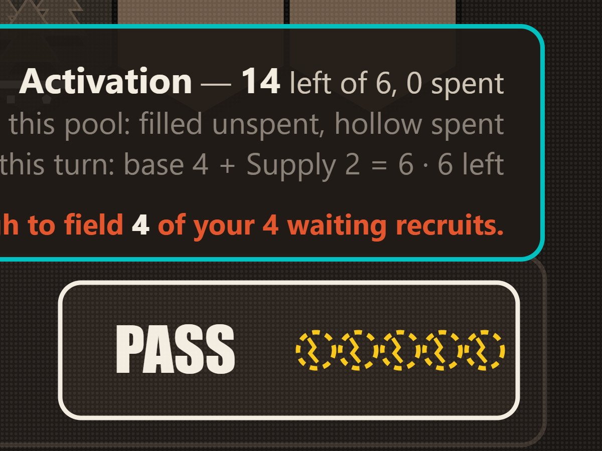
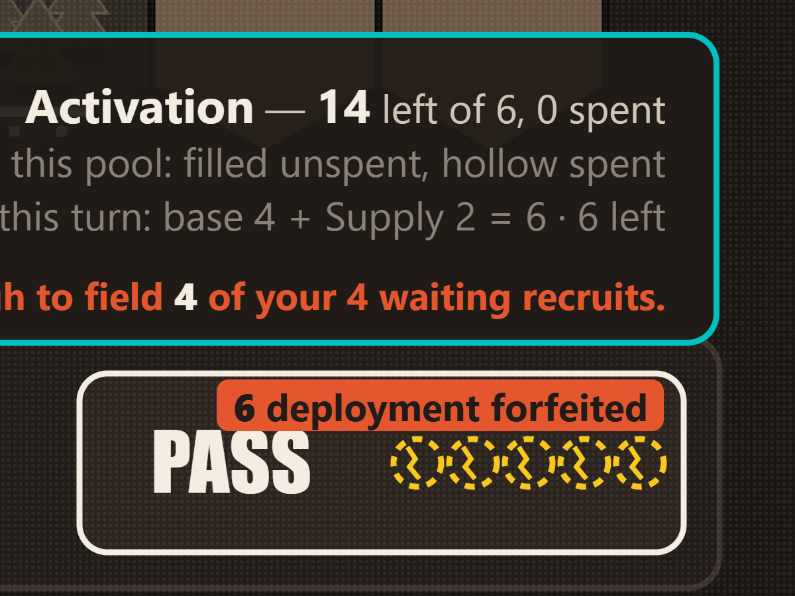

# shadowbox.html — an experimental Shadow-Box playtest

A second, experimental playtest page served beside the established one. It is **not** a
replacement for `index.html`, which is untouched by this change and remains the supported
build.

```
                        this page                    index.html
  renderer              Shadow-Box (experimental)    the canonical interface
  opponent              the engine's sparring bot     the engine's sparring bot
  players               one human                     one human
  layout                1920×1080 canvas, scaled      responsive
  interaction           preview, then Take            direct
  status                experiment                    supported
```

## Published by the owner's decision — and one question left open

This page is published. **The owner decided to publish it on 2026-10-22, explicitly, and
without waiting for an answer on the question below.** That decision supersedes the hold
this file previously carried. It is recorded here in the owner's name because it is the
owner's, and because the question it was taken over is not closed by it.

What is actually recorded about the renderer's terms, in full:

- The Shadow-Box renderer and its graphics are **Brian Schneider's work**
  (@brianhschneider), contributed as `0da6f6b` on `Everyone-Loves-Beacon/warband-live`
  **PR #4**.
- The owner's account is that Brian authorized an **earlier, MIT-based** build.
- Authorization for **this** arrangement — his renderer travelling inside a build offered
  under the proprietary Limited Playtest License — was requested of him on PR #4 on
  2026-10-22, in those words.
- **No answer has been received.** Nothing written by Brian in either repository records a
  grant, a scope, or a refusal; he has not written on the subject at all. The scope of any
  earlier permission therefore remains unresolved, and this file does not resolve it.
- **The owner has decided to proceed regardless.**

**That decision is not Brian's approval, and must never be described as one.** It is not a
grant of permission and it is not evidence of one. Anyone reading this file later should
take the permission question as open and the publication as the owner's own act.

There is also **no prohibition** to report: Brian has recorded neither permission nor
refusal on this distribution, and no licence or statement in either repository forbids it.
`docs/RIGHTS.md` in `warband-live` holds the complete evidence, deliberately split into what
the repositories verify and what rests on assertion; it is the place to look, not this
summary.

The separate terms below stand unchanged. The rules are the owner's and proprietary; the
renderer is Brian's and is **not** licensed to anyone by this page.

### Closed: the canonical rules commit is published

This file used to carry a second blocker — that `eb49d71` existed on one machine and on no
remote — and it is **closed**. The commit is now on the branch `licence/limited-playtest` of
`frankgilson-lab/warband-prototype`, pushed by explicit refspec as a single commit on top of
the MIT baseline `31ed777`. After the push it was verified three independent ways, each
reporting that exact SHA and that parent: a fresh clone into an empty directory, the GitHub
API, and `git ls-remote`. The rules themselves did not move — `games/warband` is the *same
tree object* at `31ed777` and at `eb49d71`, which is to say the licence changed and the game
did not.

**That repository is private, and the owner has decided it stays private.** So the commit's
provenance is verifiable by anyone authorized on the repository and by nobody else: its
GitHub links return 404 to an anonymous request, as does `git ls-remote` without
credentials. This is the intended end state rather than a gap still to be closed —
publishing the canonical source was never the aim, and the licence embedded in this page
forbids redistributing the rules in the first place.

## What it is built from

Three pinned commits, and nothing else.

| part | repository | commit |
|---|---|---|
| canonical rules | `frankgilson-lab/warband-prototype` (private), `licence/limited-playtest` | `eb49d71338e270efffa618ebadd8c31314aebeaa` |
| Shadow-Box renderer | `Everyone-Loves-Beacon/warband-live`, PR #4 | `0da6f6b2314122851acbbd819bd016573071498d` |
| explanatory UX layer | `Everyone-Loves-Beacon/warband-live`, `playtest/shadowbox-ux` | `80dbe4ef6b57aac013d676ff46f75c6012778a40` |

All three SHAs are stamped into the page — in full in the opening notice and in the `title`
of the stamp at the bottom right, in short form in the stamp itself — so feedback can be
tied to an exact build.

The three rules files are carried byte for byte, re-derived from the upstream commit at
build time rather than taken on the word of `rules/MIRROR.json`:

| file | bytes | sha256 |
|---|---|---|
| `config.js` | 68,105 | `ba35f20ab33e4e401ae88b9f139ffbf38e911d0c5ce0a05694331599ddd54f38` |
| `core.js` | 122,593 | `b175ded9f00c4b029beb83acc04a60749e2bbeee84788bd785709c0183cb4790` |
| `engine.js` | 508,065 | `ae1ce0780b2e6dfca52738ca71e69329adb3e65822257b3d6b9ecc5703153f42` |

And the artifact they make:

```
shadowbox.html
1,112,451 bytes
sha256  21bd3004147e0577071bf45364b2599f199ab420aae10296e2ac5e282a1bd1ea
```

### What these hashes prove, and what they do not

Two different claims live in this file, and only one of them is checkable by a reader
without repository access.

- **The artifact is publicly verifiable.** Once the page is live, anyone can fetch it and
  compute `21bd3004…` for themselves. That settles which bytes are being served, and that
  they are the bytes every suite below was run against.
- **The build's ancestry is not.** The three rules-file hashes above, the licence hash
  below, and the three pinned SHAs are a *manifest of the inputs* — and all three
  repositories they name are private. A reader outside them cannot recompute a single one of
  those digests, so the manifest records what was measured rather than proving it: only the
  private history it was measured against can confirm it. Independent verification of the
  ancestry needs access to `frankgilson-lab/warband-prototype` and
  `Everyone-Loves-Beacon/warband-live`, which is granted person by person and not by this
  file. A matching hash in a document is evidence of care, not a proof of provenance.

## Two works, two sets of terms

This matters more than its position in a README suggests, so it is stated before the build
instructions rather than after the limitations.

- **The canonical Warband rules are proprietary from `eb49d71` onward**, under the
  **Limited Playtest License v0.1**, Copyright © 2026 Frank Trevor Gilson, all rights
  reserved. It grants a personal, non-transferable permission to play this build for
  evaluation and playtesting, and permits no redistribution, sale, sublicensing,
  publication, modification or derivative work. The licence is **embedded verbatim, twice**
  — as an HTML comment at the top of the file, where it can never be dismissed or restyled
  away, and as a readable panel in the opening notice. Both copies are `eb49d71:LICENSE`
  byte for byte: **1,782 bytes** — 1,779 Unicode characters, the three-byte difference being
  the em dash in its title and the `©` in its copyright line — sha256
  `d24c1c5e5a17155ee1ca530a4e159e0a8c8880709636e60d754b5535adfabcb7`.
- **The Shadow-Box renderer and its graphics are Brian Schneider's work**
  (@brianhschneider). The permission the owner reports is for the earlier MIT build;
  **permission for this one was requested and has not been answered**, and the page is
  published on the owner's decision rather than on an answer (see the top of this file).
  Permission is not a licence in any case: the renderer is not covered by the rules' licence, and
  nothing here grants anyone the right to reuse it. The page says so in the same words, in
  the notice and in the permanent stamp.

The builder reads the licence out of the same commit as the rules and **refuses to build**
if it is missing or is not a licence it recognises — so the terms travel with every future
build rather than with the one artifact somebody remembered to paste them into. It
recognises both the historical MIT text and the Limited Playtest License, which is what
lets the MIT-licensed `31ed777` build still be reproduced today.

## Rebuilding it

The generated HTML is **not** a source. Edit the prototype or the builder, never the output.

The builder lives with the renderer it inlines, in `warband-live`:

```
node scripts/build-shadowbox.mjs \
  --app-ref    0da6f6b \
  --rules-repo ../warband \
  --ux-ref     80dbe4e \
  --out        ../warband-playtest/shadowbox.html
```

`--rules-ref` defaults to `eb49d71`. Passing `--rules-ref 31ed777` reproduces the earlier
MIT-licensed artifact instead, licence and all.

It reads every input out of git rather than the working tree, so a dirty checkout cannot
leak into a build; it refuses outright if the working tree differs from the ref it was told
to build. `--explain` prints the complete list of changes applied to the renderer.

## What changed since the MIT candidate

The earlier candidate on this branch (`2dc2316`, 800,497 bytes) was the renderer and the
rules alone. This one adds the explanatory layer described below, moves the rules from MIT
`31ed777` to the proprietary `eb49d71`, and carries one correction found by a human
playing the build it supersedes.

**HP-001 — the PASS button understated what passing throws away.** At seed 2147398896,
turn 3, a company holding six deployment points (base 4 and two Sutlers' Supply) saw five
cracked coins on the button. The renderer draws one coin per point and stops at five
because a sixth does not fit; the forfeiture has no such limit. The renderer is pinned and
was not changed. When more than five would be forfeited — and only then — the explanatory
layer now states the exact total across the top of the button, reading the same
`wbPassForfeits` the warning above it and the confirmation dialog read.

| before | after |
|---|---|
|  |  |

## How this exact file was verified

Every suite below was run against **this artifact** — the file in this commit, sha256
`21bd3004…`, built from the final commit before any suite started — one at a time, never
two at once.

| suite | result |
|---|---|
| PASS forfeiture (HP-001) | 52 / 52 |
| playtest report | 158 / 158 |
| objective history | 135 / 135 |
| Chronicle | 90 / 90 |
| match lifecycle | 45 / 45 |
| results and the plaque | 208 / 208 |
| verdict | 67 / 67 |
| battle record | 56 / 56 |
| licence gate, incl. the historical MIT build | 57 / 57 |
| seizure regression | correct — announced as a seizure |
| standalone acceptance | 71 / 71 |
| explanatory layer acceptance | 258 / 258 |
| unit tests (vitest, 6 files) | 159 passed |
| rules mirror against upstream | the mirror is clean — no fork |

The gate's five provenance checks need the earlier MIT artifact to compare against, so a
`--rules-ref 31ed777` build was made from the same UX commit and passed to it; that is the
only other artifact involved, and nothing about this one is inferred from it.

### Self-containment

No externally loaded JavaScript, stylesheet, font, image, XHR, socket or backend. The
standalone acceptance opens the file in Chromium **with every URL blocked and the
connection emulated offline**, plays to a verdict, and records that no off-origin request
was even attempted. `?seed=N` works as it does in the prototype.

## How it was deployed, and how to check it

GitHub Pages serves this repository from the **`main` branch, path `/`** (legacy build).
There is no workflow and no build step: a file merged to `main` is the file served.

1. Deployment PR **#1** was merged into `main` on the owner's authorization of 2026-10-22.
2. Wait for the Pages build to report `built`:
   `gh api repos/frankgilson-lab/warband-playtest/pages --jq .status`
3. Fetch the published page and check it against the artifact, rather than trusting the
   deploy:
   ```
   curl -fsSL https://frankgilson-lab.github.io/warband-playtest/shadowbox.html | sha256sum
   ```
   It must print the sha256 above. A PR preview, a local open or an inspection of the
   committed file proves nothing about the public URL.
4. Open `https://frankgilson-lab.github.io/warband-playtest/shadowbox.html` in a browser,
   accept the licence on the start screen, and play one turn. The page is self-contained, so
   it must work with no further network access at all.
5. Check `https://frankgilson-lab.github.io/warband-playtest/` still serves the original
   playtest, unchanged.

### Rolling it back

Nothing about this deployment is irreversible, and the original page is never in its path.

- **To withdraw the Shadow-Box page**: `git rm shadowbox.html` on `main` and push. The URL
  returns 404 and `index.html` is untouched — it has never been modified by this work, and
  its blob is identical on `main` and on the candidate branch
  (`622b4cfd9266dff240adaae3dd73a610664c2097`, sha256
  `aea188b3b52fb341e7f604e9ba78a5775a70978c431ca89cbbcdd9d99c0e9a58`).
- **To go back to the earlier MIT-licensed candidate**, which asks nothing of Brian beyond
  the permission already on record:
  `git checkout 2dc2316 -- shadowbox.html SHADOWBOX.md` (800,497 bytes, sha256
  `7d4e605da43402da6cfa8a176d5d326a89e31d0b905cb4c9a730dc5b13a2c439`), or rebuild it with
  `--rules-ref 31ed777`.
- **To revert the whole deployment**: `git revert` the merge commit on `main`. Pages
  rebuilds from `main` on every push, so the previous state is restored by the next build.

## What the builder changes, and the list is complete

The renderer is copied verbatim. `index.html`, `kit.js` and `sb.js` are inlined as they
are; gameplay, balance, the sparring bot and every interaction decision are untouched.
**Preview-then-Take stays an experiment of this prototype's** and is labelled as such on
the page — it is not adopted for the canonical interface.

1. The verbatim licence of the rules goes in at the top of the file, with the renderer's
   separate terms stated beside it.
2. The Google Fonts `<link>` is dropped.
3. Two CSS rules redirect the renderer's two font families onto locally installed stacks.
   The renderer names fonts in SVG `font-family` **presentation attributes**, which any CSS
   rule outranks, so this needs no edit to `kit.js` or `sb.js`.
4. The script tags become inline `<script>` blocks in the same order, each headed by a
   comment naming its source commit and its terms.
5. The `<title>` says the build is experimental.
6. A dismissible notice — carrying the licence and the attribution — and a permanent
   provenance stamp are added **over** the page, so the renderer's own muster screen and
   start button are untouched.
7. The explanatory layer is added beside the renderer: it reads the engine and draws over
   the board, and it changes no rule, no score and no action.

## What the explanatory layer adds

It is additive and it is not the renderer. Everything it shows is read from the engine and
from the match record; it decides nothing.

- the action strip: whose turn it is, the activation pool, the deployment granted this turn
  and what passing would throw away;
- an inspection panel for any hex, unit or HUD symbol, pinned until dismissed;
- the Chronicle, the certified score breakdown and the objective history, as three views of
  one finished match;
- the result plaque, which withdraws its own verdict rather than show one its inputs no
  longer support;
- a playtest report the player can copy, in English whatever the interface's language;
- the start-screen licence gate, with a focus trap and an Escape path;
- Credits & Licences, naming both works and their separate terms.

## Known limitations, reported rather than designed around

- **Desktop only.** The page is one 1920×1080 canvas scaled to the viewport, so a small
  screen shrinks everything rather than reflowing it. Nothing clips and no scrollbar appears
  at any size, but the type shrinks with the board; at 640×360 most of the interface is
  unreadable. There is no mobile layout, and adding one would be a redesign of Brian's
  prototype rather than a build step. The added notice does adapt — it scrolls and compacts
  below 640px of height — because a label nobody can read is not a label.
- **No accessibility parity** with `index.html`. The board is SVG driven by pointer
  hit-testing on coordinates, with no keyboard path to a hex, no focus order and no
  accessible names for pieces. The licence gate, the notice and the explanatory layer's own
  dialogs are keyboard-reachable and dismissible with Escape; that does not extend to the
  game itself.
- **One human against the bot.** No hotseat, no second human, no audience.
- **Not Warband Live.** The streamer-versus-audience prototype is separate and is not part
  of this page.
