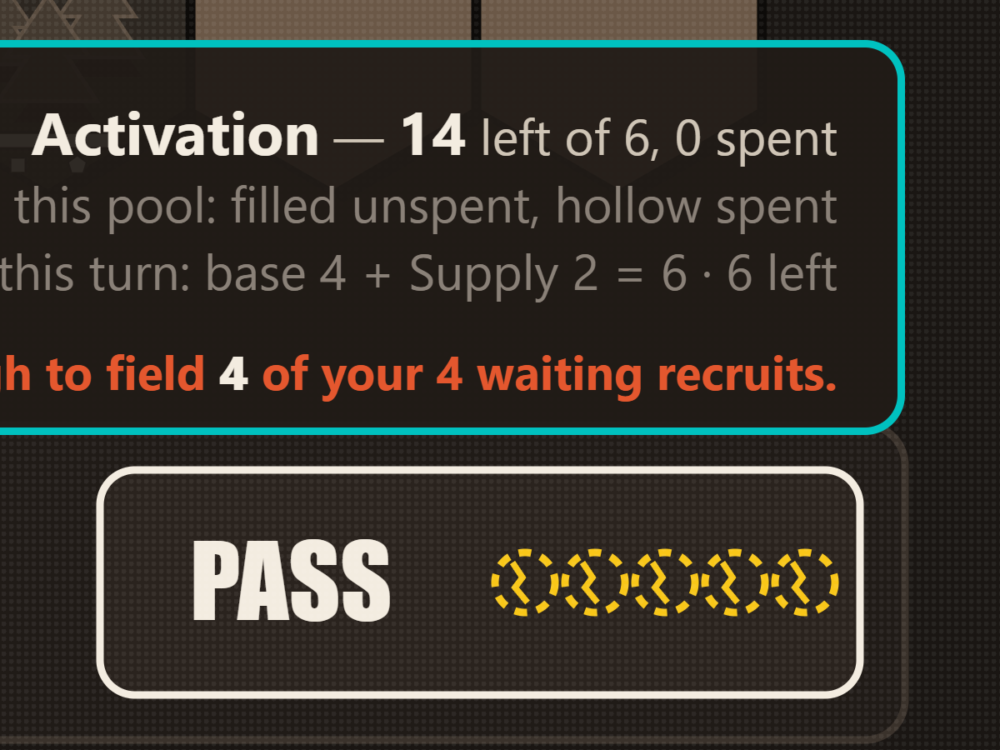
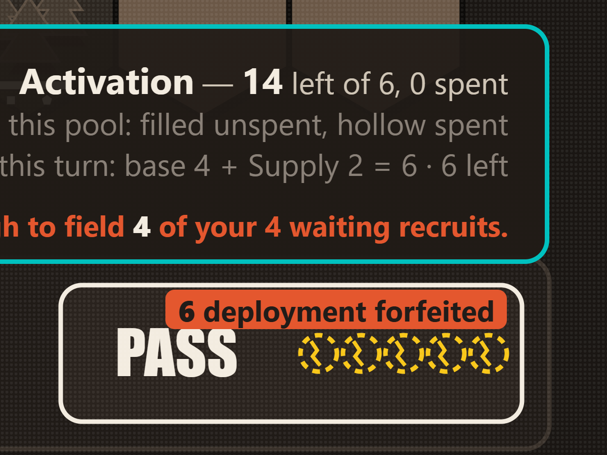

# shadowbox.html — an experimental Shadow-Box playtest

A second, experimental playtest page served beside the established one. It is **not** a
replacement for `index.html`, which is untouched by this change and remains the supported
build.

```
                        this page                    index.html
  renderer              Shadow-Box (experimental)    the canonical interface
  opponent              the engine's sparring bot     the engine's sparring bot
  players               one human                     one human
  layout                1920×1080 canvas, scaled      responsive
  interaction           preview, then Take            direct
  status                experiment                    supported
```

## Published by the owner's decision — and one question left open

This page is published. **The owner decided to publish it on 2026-10-22, explicitly, and
without waiting for an answer on the question below.** That decision supersedes the hold
this file previously carried. It is recorded here in the owner's name because it is the
owner's, and because the question it was taken over is not closed by it.

**UX-03.6r, published 2026-11-01, is the third release under that same decision.** The
owner authorized this publication explicitly. Nothing below has changed in the meantime:
no answer has been received, nothing new has been granted, and this release neither
closes the question nor reopens it. A third publication under an unresolved permission is
still an unresolved permission.

What is actually recorded about the renderer's terms, in full:

- The Shadow-Box renderer and its graphics are **Brian Schneider's work**
  (@brianhschneider), contributed as `0da6f6b` on `Everyone-Loves-Beacon/warband-live`
  **PR #4**.
- The owner's account is that Brian authorized an **earlier, MIT-based** build.
- Authorization for **this** arrangement — his renderer travelling inside a build offered
  under the proprietary Limited Playtest License — was requested of him on PR #4 on
  2026-10-22, in those words.
- **No answer has been received.** Nothing written by Brian in either repository records a
  grant, a scope, or a refusal; he has not written on the subject at all. The scope of any
  earlier permission therefore remains unresolved, and this file does not resolve it.
- **The owner has decided to proceed regardless.**

**That decision is not Brian's approval, and must never be described as one.** It is not a
grant of permission and it is not evidence of one. Anyone reading this file later should
take the permission question as open and the publication as the owner's own act.

There is also **no prohibition** to report: Brian has recorded neither permission nor
refusal on this distribution, and no licence or statement in either repository forbids it.
`docs/RIGHTS.md` in `warband-live` holds the complete evidence, deliberately split into what
the repositories verify and what rests on assertion; it is the place to look, not this
summary.

The separate terms below stand unchanged. The rules are the owner's and proprietary; the
renderer is Brian's and is **not** licensed to anyone by this page.

### Closed: the canonical rules commit is published

This file used to carry a second blocker — that `eb49d71` existed on one machine and on no
remote — and it is **closed**. The commit is now on the branch `licence/limited-playtest` of
`frankgilson-lab/warband-prototype`, pushed by explicit refspec as a single commit on top of
the MIT baseline `31ed777`. After the push it was verified three independent ways, each
reporting that exact SHA and that parent: a fresh clone into an empty directory, the GitHub
API, and `git ls-remote`. The rules themselves did not move — `games/warband` is the *same
tree object* at `31ed777` and at `eb49d71`, which is to say the licence changed and the game
did not.

**That repository is private, and the owner has decided it stays private.** So the commit's
provenance is verifiable by anyone authorized on the repository and by nobody else: its
GitHub links return 404 to an anonymous request, as does `git ls-remote` without
credentials. This is the intended end state rather than a gap still to be closed —
publishing the canonical source was never the aim, and the licence embedded in this page
forbids redistributing the rules in the first place.

## What it is built from

Three pinned commits, and nothing else.

| part | repository | commit |
|---|---|---|
| canonical rules | `frankgilson-lab/warband-prototype` (private), `integration/guard-repair-on-licence` | `5bbcbcf1cc2ffa214ed296777b7b666271c66d07` |
| Shadow-Box renderer | `Everyone-Loves-Beacon/warband-live` | `b27b373899bb6358b533ab438d4a5117052e73aa` |
| explanatory UX layer | `Everyone-Loves-Beacon/warband-live`, `integration/ux036-hold-repair` | `f7da7eead0e96c02120894c86ba6a49bdfe5672b` |

The rules also carry a **revision string**, `supply-1+abilities-2+guard-1`, stamped into
the page, which two builds compare so that mismatched ones refuse each other. It is how
the Guard repair in this release is named rather than merely present.

**All three of those commits are, at the time of writing, on this machine and on no
remote.** Each was asked of GitHub by SHA and each answered *No commit found*. That is a
weaker position than UX-03.4b held, and the subsection below says what it costs a reader.

All three SHAs are stamped into the page — in full in the opening notice and in the `title`
of the stamp at the bottom right, in short form in the stamp itself — so feedback can be
tied to an exact build.

The three rules files are carried byte for byte, re-derived from the upstream commit at
build time rather than taken on the word of `rules/MIRROR.json`:

| file | bytes | sha256 |
|---|---|---|
| `config.js` | 69,426 | `56b8e74ce251861419b942344a2c6ef95847775b11ad64072a48e94cc8b20f90` |
| `core.js` | 126,638 | `8381d4a2a3177fa66123582d01e28aa3d6700b2a42b7b76978cf4b760599b2ea` |
| `engine.js` | 509,845 | `cd2e6c3d60f11026e220ce0b50da1530e985e949eaab25de0c8f4605c0d62fca` |

**All three of those digests have changed since the previous published version**, and that
is this release's headline rather than an incidental. For UX-03.4b the check was that the
rules had *not* moved with the interface; here they moved on purpose, because the Guard
repair is a rules correction.

Byte counts here are git object sizes, which is what a reader fetching the blob would
measure; the builder prints character counts, and the licence section below gives both for
the one file where the difference matters.

And the artifact they make:

```
shadowbox.html  (UX-03.6r, published 2026-11-01)
1,333,669 bytes
sha256  500f82db2078ad0cbb772e96f988e8a8046f5577410f4e3eeec5b2884b357a50
```

Every pin moved this time: the rules from `eb49d71` to `5bbcbcf` for the Guard repair, the
renderer from `0da6f6b` to `b27b373`, and the explanatory layer across 44 commits from
`6b393e6` to `f7da7ee`.

**The previous published version is retained** and is the rollback target:

```
shadowbox.html  (UX-03.4b, published 2026-10-27, superseded)
1,269,564 bytes
sha256  0a8619c96243b8db97a4592b8476fdbd3de4a6b7e8ff9d25c585510da36c9332
git      e375e1766fee630e3d57b34a78b2d7d5dfa4a371   blob 5c19a031217b2a8692f45ea092d0c8cc8ce1ba5c
```

### What these hashes prove, and what they do not

Two different claims live in this file, and only one of them is checkable by a reader
without repository access.

- **The artifact is publicly verifiable.** Once the page is live, anyone can fetch it and
  compute `500f82db…` for themselves. That settles which bytes are being served, and that
  they are the bytes every suite below was run against.
- **The build's ancestry is not, and for this release it is weaker than that.** The three
  rules-file hashes above, the licence hash below and the three pinned SHAs are a
  *manifest of the inputs*. For UX-03.4b those inputs sat in private repositories: a
  reader outside them could not recompute the digests, but an authorized one could. For
  **UX-03.6r none of the three commits is on any remote at all** — `5bbcbcf`,
  `b27b373` and `f7da7ee` were each asked of GitHub by SHA and each answered *No commit
  found*. The manifest is therefore confirmable only on the machine that built it, and by
  whoever has that machine: not by an authorized collaborator, and not by the GitHub API.
  Pushing those three commits to their private remotes would restore the position
  UX-03.4b held, and until that is done this is the honest statement of what the manifest
  is worth. A matching hash in a document is evidence of care, not a proof of provenance.

## Two works, two sets of terms

This matters more than its position in a README suggests, so it is stated before the build
instructions rather than after the limitations.

- **The canonical Warband rules are proprietary from `eb49d71` onward**, under the
  **Limited Playtest License v0.1**, Copyright © 2026 Frank Trevor Gilson, all rights
  reserved. It grants a personal, non-transferable permission to play this build for
  evaluation and playtesting, and permits no redistribution, sale, sublicensing,
  publication, modification or derivative work. The licence is **embedded verbatim, twice**
  — as an HTML comment at the top of the file, where it can never be dismissed or restyled
  away, and as a readable panel in the opening notice. Both copies are `5bbcbcf:LICENSE`
  byte for byte: **1,782 bytes** — 1,779 Unicode characters, the three-byte difference being
  the em dash in its title and the `©` in its copyright line — sha256
  `d24c1c5e5a17155ee1ca530a4e159e0a8c8880709636e60d754b5535adfabcb7`.
- **The Shadow-Box renderer and its graphics are Brian Schneider's work**
  (@brianhschneider). The permission the owner reports is for the earlier MIT build;
  **permission for this one was requested and has not been answered**, and the page is
  published on the owner's decision rather than on an answer (see the top of this file).
  Permission is not a licence in any case: the renderer is not covered by the rules' licence, and
  nothing here grants anyone the right to reuse it. The page says so in the same words, in
  the notice and in the permanent stamp.

The builder reads the licence out of the same commit as the rules and **refuses to build**
if it is missing or is not a licence it recognises — so the terms travel with every future
build rather than with the one artifact somebody remembered to paste them into. It
recognises both the historical MIT text and the Limited Playtest License, which is what
lets the MIT-licensed `31ed777` build still be reproduced today.

## Rebuilding it

The generated HTML is **not** a source. Edit the prototype or the builder, never the output.

The builder lives with the renderer it inlines, in `warband-live`:

```
node scripts/build-shadowbox.mjs \
  --app-ref    b27b373 \
  --rules-ref  5bbcbcf \
  --rules-repo ../warband \
  --ux-ref     f7da7ee \
  --out        ../warband-playtest/shadowbox.html
```

**Pass `--rules-ref` explicitly.** It still defaults to `eb49d71`, the pre-Guard commit, so
a build that omits it produces the *previous* rules under this release's interface — a
combination that has never been certified and that the revision string
`supply-1+abilities-2+guard-1` exists to make visible. Passing `--rules-ref 31ed777`
reproduces the original MIT-licensed artifact instead, licence and all.

It reads every input out of git rather than the working tree, so a dirty checkout cannot
leak into a build; it refuses outright if the working tree differs from the ref it was told
to build. `--explain` prints the complete list of changes applied to the renderer.

## What changed since the previous published version

Forty-four commits of the explanatory layer between `6b393e6` and `f7da7ee`, and — for
the first time in this page's history — **three commits of the rules**, between `eb49d71`
and `5bbcbcf`.

### The rules moved: the Guard repair

`5303c8a` **Guard: price each protector against the blow it will actually take.** A unit
that guards another was being priced against the wrong attack, so a protector's survival
was computed from a blow other than the one it would take. This is a correctness repair to
the engine, not a balance change dressed as one, and it is the reason the rules pin moved.
`7f27fdc` retires a near-zero population pin on Watch-Fire and tests the third applier.
`5bbcbcf` adds the revision string so that a build on the old rules and a build on the new
ones refuse each other instead of quietly disagreeing.

`games/warband` changed across four files — `config.json`, `core.js`, `engine.js` and
`interface.js` — 100 lines added and 14 removed. The three rules-file digests in the
manifest above all moved with them, which is the check that the change is really in the
rules and not only in the interface.

### The interface: UX-03.5, UX-03.6 and the UX-03.6r repair

| | what it answers |
|---|---|
| **UX-03.5** | the Guard repair made visible where a player decides: a protector's survival is shown against the blow it will actually take |
| **UX-03.6 (1)** | a persistent inspection panel paints *above* the selection brackets instead of being obscured by them |
| **UX-03.6 (2)** | PASS confirms immediately when nothing has been committed, in one dialog when deployment is forfeited too, read from authoritative game state rather than a second counter |
| **UX-03.6 (3)** | the death notice is about three seconds rather than seven, rings the hex it is about, and can be put down |
| **UX-03.6 (4)** | "Units defeated" and "Left the field" are named as what they are, in the interface and in the deterministic report together |
| **UX-03.6 (5)** | the redundant Chronicle/victory-points footer switcher is gone; How to play, Map key, Credits & licences and Feedback remain |
| **UX-03.6 (6)** | coin spacing, terrain name and "Left by Company X" readability, and an endgame inspector that no longer covers the footer controls |
| **UX-03.6r** | **the death notice takes no click off the board** |

**UX-03.6r is this release's correctness headline on the interface side, and it exists
because UX-03.6 as first built was wrong.** Giving the notice a dismissal control had been
done by making the whole notice clickable, and the explanatory layer grants pointer events
only to elements that ask for them — so the notice became a solid object lying over the
board. Because it is placed beside the hex that just died, it covered playable ground: a
click on a legal target underneath it was swallowed, the attack never happened, nothing was
spent, the selection did not move, and the player was told nothing at all. Three Tier 2
suites caught it. The repair grants pointer events to the dismissal control alone;
click-anywhere dismissal is gone, and the control and the Escape key remain.

Measured across the notice's body on a grid of twenty-five points: **none** of them reached
the board on the build that had the defect, and **all twenty-five** reach it on this one.

Those task records live in `warband-live/docs/`, one per item, and are not public.

## What changed since the MIT candidate

The earlier candidate on this branch (`2dc2316`, 800,497 bytes) was the renderer and the
rules alone. This one adds the explanatory layer described below, moves the rules from MIT
`31ed777` to the proprietary `eb49d71`, and carries one correction found by a human
playing the build it supersedes.

**HP-001 — the PASS button understated what passing throws away.** At seed 2147398896,
turn 3, a company holding six deployment points (base 4 and two Sutlers' Supply) saw five
cracked coins on the button. The renderer draws one coin per point and stops at five
because a sixth does not fit; the forfeiture has no such limit. The renderer is pinned and
was not changed. When more than five would be forfeited — and only then — the explanatory
layer now states the exact total across the top of the button, reading the same
`wbPassForfeits` the warning above it and the confirmation dialog read.

| before | after |
|---|---|
|  |  |

## How this exact file was verified

Every suite below was run against **this artifact** — the file in this commit, sha256
`500f82db…` — one at a time, never two at once. This is the project's Tier 2 gate,
its complete manifest, run once: **23 of 23 steps green, exit 0, in 1,634.7s**.

| step | result |
|---|---|
| unit tests (vitest, 8 files) | **186 passed** |
| results and the plaque | 212 / 212 |
| licence gate | 52 / 52 |
| match lifecycle | 45 / 45 |
| PASS forfeiture | 94 / 94 |
| playtest report | 158 / 158 |
| Chronicle | 90 / 90 |
| objective history | 135 / 135 |
| battle record | 56 / 56 |
| verdict | 67 / 67 |
| guidance strip | 210 / 210 |
| affordances | 25 / 25 |
| explanations | 41 / 41 |
| map answer | 50 / 50 |
| combat forecast | 34 / 34 |
| clicks, legal and refused | 35 / 35 |
| endgame hex inspector | 45 / 45 |
| objectives held and Regroup scoring | 83 / 83 |
| **the death notice** | **252 / 252** |
| clarity | 160 / 160 |
| seizure regression | correct — announced as a seizure |
| explanatory layer acceptance | **273 / 273** |
| standalone acceptance | **71 / 71** |

**2,188 suite checks and 186 unit tests passed; 0 failed, 0 skipped.** The rules mirror was re-derived from
upstream at build time and matches byte for byte — no fork. A further focused suite, the
death notice's pointer contract, passed 20 of 20 against this file; it is run explicitly
rather than as part of the battery.

Three things about that gate are worth recording, because a green number is worth less than
the account of how it was obtained.

- **The first attempt at this gate failed, and the failure was real.** It came back 19 of
  23 with nine failing checks, eight of them one defect: the death-notice pointer
  interception described above. The build was held, not shipped, and UX-03.6r is the
  repair. The three suites that caught it were re-run against both artifacts to prove the
  direction: green on the repaired file, red on the one that had the defect.
- **One of the four failing suites was the gate's own plumbing.** The tier runner passed
  each suite the artifact path and nothing else, so the three provenance-checking suites
  fell back to a hard-coded rules commit of 2026-10-21 and failed *any* artifact built on
  a later one. That made a green Tier 2 unobtainable for this rules lineage whatever the
  artifact contained. The runner now requires the build refs, resolves them in the right
  repository, cross-checks them against the page's own stamps and forwards them only to
  the suites that read them; a missing or wrong ref is refused outright rather than
  silently replaced by a default. Four negative controls confirm the refusal, including
  the exact stale ref that caused the original false failure.
- **The artifact was validated as the file, not as a checkout.** The suites ran against
  this exact HTML.

### Self-containment

No externally loaded JavaScript, stylesheet, font, image, XHR, socket or backend. The
standalone acceptance opens the file in Chromium **with every URL blocked and the
connection emulated offline**, plays to a verdict, and records that no off-origin request
was even attempted. `?seed=N` works as it does in the prototype.

## How it was deployed, and how to check it

GitHub Pages serves this repository from the **`main` branch, path `/`** (legacy build).
There is no workflow and no build step: a file merged to `main` is the file served.

1. **UX-03.6r was published on 2026-11-01**, by the owner's explicit authorization to
   promote it as the current public-facing Shadow-Box playtest. It was committed directly
   to `main`, superseding `e375e176`. It replaced `shadowbox.html` and this file and
   touched nothing else; `index.html` is byte-identical across the release, blob
   `622b4cfd9266dff240adaae3dd73a610664c2097`. The served bytes were checked against the
   artifact rather than against the Pages status.
1. **UX-03.4b was published on 2026-10-27**, by the owner's explicit authorization to
   promote it as the current public-facing Shadow-Box playtest. Deployment PR **#3**,
   merged into `main` as **`11dae9d56595475da8a5f793e9ec3668d6ab22d8`** — the
   publication commit. GitHub Pages built it in 35.5s and reports `built`, and
   the served bytes were checked against the artifact rather than the status.
   It replaced
   `shadowbox.html` and this file and touched nothing else; `index.html` is
   byte-identical across the release, blob
   `622b4cfd9266dff240adaae3dd73a610664c2097`.
1. The first Shadow-Box deployment, PR **#1**, was merged into `main` on the owner's
   authorization of 2026-10-22.
2. Wait for the Pages build to report `built`:
   `gh api repos/frankgilson-lab/warband-playtest/pages --jq .status`
3. Fetch the published page and check it against the artifact, rather than trusting the
   deploy:
   ```
   curl -fsSL https://frankgilson-lab.github.io/warband-playtest/shadowbox.html | sha256sum
   ```
   It must print the sha256 above — `500f82db…`. A PR preview, a local open or an
   inspection of the committed file proves nothing about the public URL, and neither does
   a Pages status of `built`. Add a cache-busting query if a stale copy is suspected.
4. Open `https://frankgilson-lab.github.io/warband-playtest/shadowbox.html` in a browser,
   accept the licence on the start screen, and play one turn. The page is self-contained, so
   it must work with no further network access at all.
5. Check `https://frankgilson-lab.github.io/warband-playtest/` still serves the original
   playtest, unchanged.

### Rolling it back

Nothing about this deployment is irreversible, and the original page is never in its path.

- **To withdraw the Shadow-Box page**: `git rm shadowbox.html` on `main` and push. The URL
  returns 404 and `index.html` is untouched — it has never been modified by this work, and
  its blob is identical on `main` and on the candidate branch
  (`622b4cfd9266dff240adaae3dd73a610664c2097`, sha256
  `aea188b3b52fb341e7f604e9ba78a5775a70978c431ca89cbbcdd9d99c0e9a58`).
- **To go back to the previous published Shadow-Box** (UX-03.4b of 2026-10-27, which is
  the current rollback target):
  `git checkout e375e17 -- shadowbox.html SHADOWBOX.md` (1,269,564 bytes, sha256
  `0a8619c96243b8db97a4592b8476fdbd3de4a6b7e8ff9d25c585510da36c9332`), or rebuild it with
  `--app-ref 0da6f6b --rules-ref eb49d71 --ux-ref 6b393e6`. That also returns the rules to
  the pre-Guard commit, which is the point of the revision string: the two will not be
  confused for each other.
- **To go back to the 2026-10-22 release**:
  `git checkout ceaf85a -- shadowbox.html SHADOWBOX.md` (1,112,451 bytes, sha256
  `21bd3004147e0577071bf45364b2599f199ab420aae10296e2ac5e282a1bd1ea`). That restores the prior page and its release documentation together,
  and leaves `index.html` alone.
- **To go back to the earlier MIT-licensed candidate**, which asks nothing of Brian beyond
  the permission already on record:
  `git checkout 2dc2316 -- shadowbox.html SHADOWBOX.md` (800,497 bytes, sha256
  `7d4e605da43402da6cfa8a176d5d326a89e31d0b905cb4c9a730dc5b13a2c439`), or rebuild it with
  `--rules-ref 31ed777`.
- **To revert the whole deployment**: `git revert` the merge commit on `main`. Pages
  rebuilds from `main` on every push, so the previous state is restored by the next build.

## What the builder changes, and the list is complete

The renderer is copied verbatim. `index.html`, `kit.js` and `sb.js` are inlined as they
are; gameplay, balance, the sparring bot and every interaction decision are untouched.
**Preview-then-Take stays an experiment of this prototype's** and is labelled as such on
the page — it is not adopted for the canonical interface.

1. The verbatim licence of the rules goes in at the top of the file, with the renderer's
   separate terms stated beside it.
2. The Google Fonts `<link>` is dropped.
3. Two CSS rules redirect the renderer's two font families onto locally installed stacks.
   The renderer names fonts in SVG `font-family` **presentation attributes**, which any CSS
   rule outranks, so this needs no edit to `kit.js` or `sb.js`.
4. The script tags become inline `<script>` blocks in the same order, each headed by a
   comment naming its source commit and its terms.
5. The `<title>` says the build is experimental.
6. A dismissible notice — carrying the licence and the attribution — and a permanent
   provenance stamp are added **over** the page, so the renderer's own muster screen and
   start button are untouched.
7. The explanatory layer is added beside the renderer: it reads the engine and draws over
   the board, and it changes no rule, no score and no action.

## What the explanatory layer adds

It is additive and it is not the renderer. Everything it shows is read from the engine and
from the match record; it decides nothing.

- the action strip: whose turn it is, the activation pool, the deployment granted this turn
  and what passing would throw away;
- an inspection panel for any hex, unit or HUD symbol, pinned until dismissed;
- how many objectives each company holds, at all times during a battle, and an
  announcement at each Regroup of what that holding paid — including a tie, which pays
  nothing and used to say nothing;
- the Chronicle, the certified score breakdown and the objective history, as three views of
  one finished match;
- the result plaque, which withdraws its own verdict rather than show one its inputs no
  longer support;
- a playtest report the player can copy, in English whatever the interface's language;
- the start-screen licence gate, with a focus trap and an Escape path;
- Credits & Licences, naming both works and their separate terms.

## Known limitations, reported rather than designed around

- **Desktop only.** The page is one 1920×1080 canvas scaled to the viewport, so a small
  screen shrinks everything rather than reflowing it. Nothing clips and no scrollbar appears
  at any size, but the type shrinks with the board; at 640×360 most of the interface is
  unreadable. There is no mobile layout, and adding one would be a redesign of Brian's
  prototype rather than a build step. The added notice does adapt — it scrolls and compacts
  below 640px of height — because a label nobody can read is not a label.
- **No accessibility parity** with `index.html`. The board is SVG driven by pointer
  hit-testing on coordinates, with no keyboard path to a hex, no focus order and no
  accessible names for pieces. The licence gate, the notice and the explanatory layer's own
  dialogs are keyboard-reachable and dismissible with Escape; that does not extend to the
  game itself.
- **One human against the bot.** No hotseat, no second human, no audience.
- **Not Warband Live.** The streamer-versus-audience prototype is separate and is not part
  of this page.
